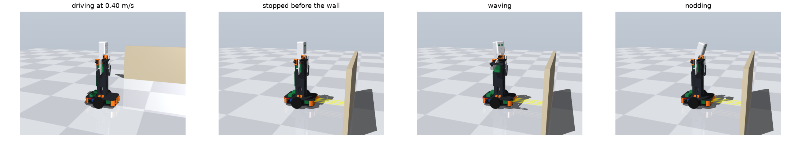
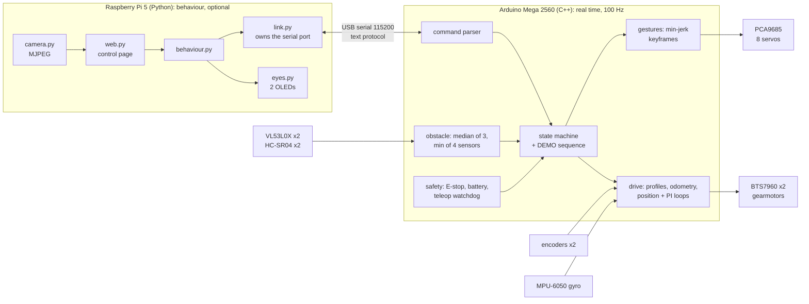
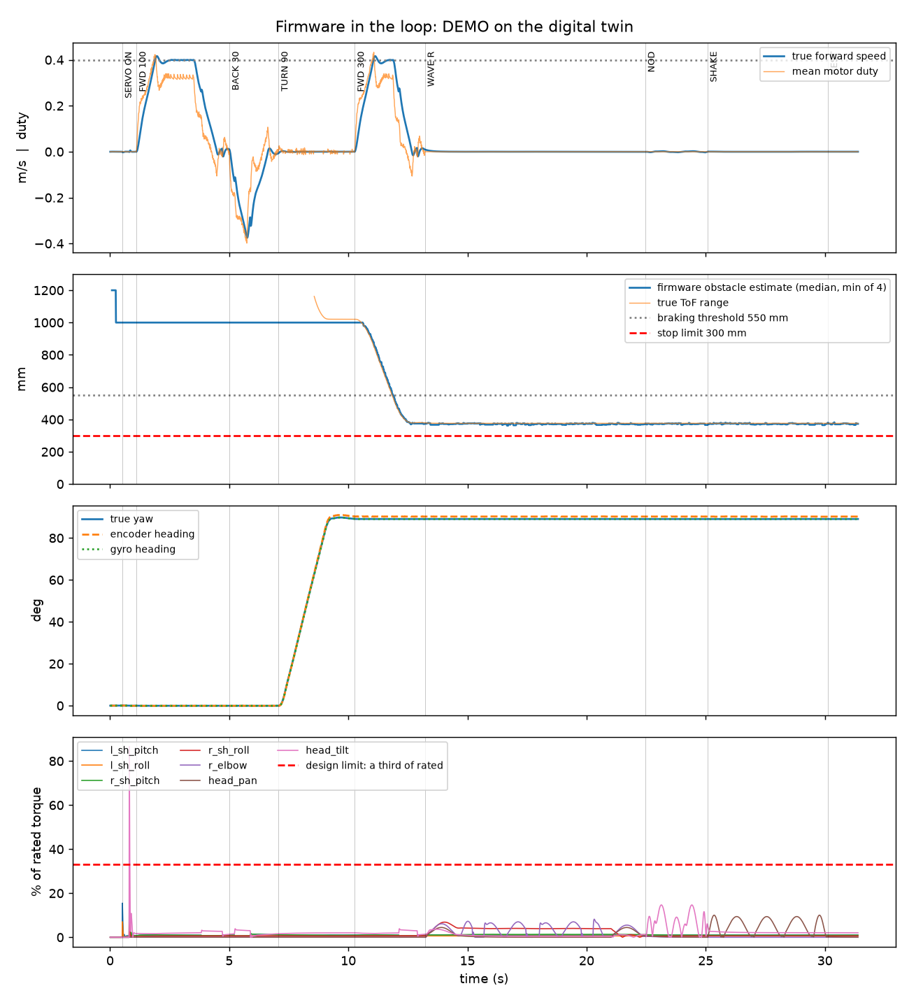

# Wheeled Humanoid

**IEEE RAS Tunisia × ODC FabLab · RAS Build Challenge, design phase · Project 2**

This is a 75 cm robot on a differential wheeled base, with two 3-DOF arms and a pan/tilt head, built from the provided kit. The repository holds the firmware, the Raspberry Pi service, the digital twin, the CAD, the fabrication files and the wiring diagram.

**Minimum demonstration (spec book):** move, turn, stop before an obstacle, perform an arm movement and a head gesture. On the robot, one command (`DEMO`) runs all of it on the Arduino Mega. In simulation, the same firmware drives the digital twin:



```bash
make -C firmware test                      # 30 unit tests of the controller
.venv/bin/python sim/firmware_sim.py       # the firmware runs DEMO on the MuJoCo twin
```

## Contents

| Folder | What it holds |
|---|---|
| [`firmware/`](firmware) | Arduino Mega 2560 firmware (PlatformIO, C++). The controller core in `lib/robot_core` contains no Arduino code, so it also runs in the unit tests and in the simulator |
| [`pi/`](pi) | Raspberry Pi 5 service (Python): link to the Mega, OLED eyes, head camera, web control page |
| [`sim/`](sim) | Digital twin (URDF + MuJoCo) generated from the CAD; firmware-in-the-loop simulation and its results |
| [`wiring/`](wiring) | Wiring diagram (draw.io source + PDF, 3 sheets: power, signals, servos) |
| [`fabrication/`](fabrication) | **Files for the FabLab:** numbered and oriented STLs (`P03_bumper_pillar_x4.stl`...), numbered DXFs (`L01_lower_deck_x1.dxf`...), and a table of material, infill, walls, orientation and supports for every part |
| [`print/`](print), [`laser/`](laser) | Source fabrication files from the CAD: 16 STL parts for 3D printing, 11 DXF plates for 5 mm laser-cut sheet |
| [`step_parts/`](step_parts), `*.step` | CAD: one STEP per part, the full assembly, and the assembly with every kit component |
| [`info/`](info) | Dimensioned drawings (30 sheets with the exploded view and parts list) |
| [`robot_viewer/`](robot_viewer) | ROS 2 description package (URDF + meshes) for RViz or any URDF viewer |

## Architecture



**Why two controllers.** The Mega does all of the real-time work: wheel control, obstacle stop, servo motion and safety. The Pi only sends text commands. The minimum demonstration therefore never depends on a Linux boot, an SD card or the camera stack. If the Pi or its service fails, the robot still drives, stops and gestures; the Pi adds character with the eyes, the camera and the web page.

**One controller, three places.** `firmware/lib/robot_core` is plain C++11 with no Arduino calls. `src/main.cpp` reads the hardware and calls `RobotCore::step()` every 10 ms. The unit tests call the same code against a motor model, and the simulator calls it through a C interface against the MuJoCo twin. Every result on this page therefore comes from the code that will be flashed.

## Firmware (Arduino Mega)

| Module | Algorithm and why |
|---|---|
| `drive.cpp` | **Motion profile:** the speed reference is ramped at 0.5 m/s² and capped at 0.40 m/s (0.12 m/s per wheel when turning). Braking follows v = √(2·0.8·a·d), so each move ends exactly on its target. **Position tracking:** each wheel follows the integral of the profile, a position reference, through a correction of 4 (m/s)/m. Tracking position, not only speed, makes the robot stop on target despite motor lag and keeps the wheels in step on straight lines. **Speed loop:** one PI loop per wheel, with feed-forward on speed and on acceleration (filtered). **Odometry:** encoders with 4× quadrature decoding; the gyro heading is integrated alongside as a cross-check (`EVT SLIP` above 10°) |
| `obstacle.h` | Median of the last 3 readings per sensor, which rejects single spikes, then the minimum over the four sensors. ToF is precise but narrow and misses dark or glossy surfaces; ultrasound is wide but coarse, so each covers the other's blind case. Braking starts below 550 mm; forward motion is allowed again above 650 mm (hysteresis). If no sensor has reported for 500 ms, forward motion is refused |
| `gestures.cpp` | Keyframes in joint space played with a minimum-jerk profile s(u) = 10u³ − 15u⁴ + 6u⁵. Each move is timed so its peak speed is 90°/s: no servo ever jumps, current peaks stay low, and a 75 cm structure does not shake. Joint limits are applied to every interpolated point; they are checked for clearance on the CAD solids (`sim/clearance.py`) |
| `robot_core.cpp` | Command parser, state machine, `DEMO` sequence, safety. **E-stop** (optional sense line D29): drivers disabled, servos released, latched until `RESET`. **Battery:** fault after 2 s below 9.9 V. **Teleop watchdog:** 500 ms. Servo strips A and B are powered 300 ms apart to halve the inrush current |
| `main.cpp` | Hardware layer: interrupt-driven encoders, non-blocking VL53L0X reads, HC-SR04 alternating every 60 ms, raw MPU-6050 gyro with its bias measured at boot, PCA9685 written only when a value changes, motor PWM at 3.9 kHz |

Libraries: `pololu/VL53L0X`, `adafruit/Adafruit PWM Servo Driver Library`, `Wire`. The encoders, sonar and IMU use our own short code to keep the 10 ms loop predictable. The build uses 3.2 KB of RAM (39 %) and 37 KB of flash (15 %).

```bash
cd firmware
pio run                  # build
pio run -t upload        # flash the Mega over USB
pio device monitor       # serial console at 115200 baud: type HELP, STATE?, DEMO
make test                # host unit tests (no hardware needed)
```

The full command list is in [`firmware/protocol.md`](firmware/protocol.md).

## Wiring and pinout

Full diagram: [`wiring/wheeled_humanoid_wiring.pdf`](wiring/wheeled_humanoid_wiring.pdf). The battery runs through the XT60, the 20 A fuse, the KCD4 switch and the E-stop. Two XL4016 converters (6.8 V) feed the two servo strips. The XY-3606 (5.1 V) feeds the Pi, and the Pi feeds the Mega over USB. Servo power never passes through the PCA9685.

| Mega pin | Signal | Mega pin | Signal |
|---|---|---|---|
| D2, D18 | Left encoder A, B (interrupts) | D22, D23 | Left HC-SR04 trig, echo |
| D3, D19 | Right encoder A, B (interrupts) | D24, D25 | Right HC-SR04 trig, echo |
| D5, D6 | Left BTS7960 RPWM, LPWM | D26, D27 | VL53L0X 1 and 2 XSHUT |
| D7, D8 | Right BTS7960 RPWM, LPWM | D28 | PCA9685 OE (high = servos released) |
| D30, D31 | Left, right driver enable | D29 | E-stop sense (optional, NO contact to GND) |
| D20, D21 | I²C SDA, SCL: PCA9685 0x40, MPU-6050 0x68, VL53L0X 0x30 and 0x29 | A0 | Battery divider 10 k / 3.3 k |

| PCA9685 channel | 0 | 1 | 2 | 3 | 4 | 5 | 6 | 7 |
|---|---|---|---|---|---|---|---|---|
| Joint | L shoulder pitch | L shoulder roll | L elbow | R shoulder pitch | R shoulder roll | R elbow | Head pan | Head tilt |
| Servo | TD-8130MG | TD-8130MG | RCXAZ | TD-8130MG | TD-8130MG | RCXAZ | MG996 | MG996 |
| Strip | A | A | A | B | B | B | A | B |

Pi 5: left OLED on I²C bus 1 (pins 3, 5); right OLED on software bus 3 (GPIO 23, 24), because both use address 0x3C. The camera uses CSI.

## Raspberry Pi service

```bash
# on the Pi (Raspberry Pi OS Bookworm), from pi/
bash setup_pi.sh                       # packages, I2C buses, USB current; then reboot
.venv/bin/python -m humanoid_pi        # web page on http://<pi address>:8080
sudo cp humanoid.service /etc/systemd/system/ && sudo systemctl enable --now humanoid   # start at boot
```

| Module | Role |
|---|---|
| `link.py` | Owns the serial port, waits for `READY` after the Mega resets, parses `STATE` (5 Hz), reconnects on its own. It also accepts `socket://host:port`, so the whole Pi stack runs against the simulator |
| `behaviour.py` | Gives the robot character from the Mega's events: surprised eyes on `EVT BLOCKED`, happy on a wave, eyes that look toward a turn, sleepy after 90 s idle, a fault face on E-stop or link loss. It makes no safety decision |
| `eyes.py` | Two SH1106 OLEDs drawn with Pillow (luma.oled) at 15 fps, with random blinks |
| `camera.py` | picamera2 MJPEG stream from the head camera |
| `web.py` | Control page: STOP, hold-to-drive pad (`VEL` every 200 ms, so the watchdog stops the robot if the page closes), moves, gestures, DEMO, live state, eyes, video. Only commands that match a whitelist are forwarded, so the `CAL` bench commands are not reachable from the network. An optional `--token` protects the page |

The page and the eyes work on a laptop too, without the OLEDs or the camera:

```bash
.venv/bin/python sim/firmware_sim.py --tcp 5555 &                                   # twin with firmware
cd pi && ../.venv/bin/python -m humanoid_pi --port socket://localhost:5555 --no-camera
# open http://localhost:8080
```

## Simulation

[`sim/README.md`](sim/README.md) describes the twin: how it is generated from the CAD, its joints, masses and sensors. [`sim/firmware_sim.py`](sim/firmware_sim.py) turns it into a hardware-in-the-loop bench:

- **Encoders:** wheel angles become counts at 1320 per turn.
- **Range sensors:** rangefinder rays become ToF readings (33 ms, ±5 mm noise, 1.2 m maximum) and ultrasonic readings (alternating every 60 ms, ±10 mm noise, 1 m maximum).
- **Gyro:** the IMU site gives the gyro rate.
- **Motors:** each gearmotor is a DC motor torque-speed line (10 kg·cm stall, 200 rpm no-load).
- **Servos:** each servo is limited to its kit rating and goes limp when it gets no pulse.

```bash
.venv/bin/python sim/firmware_sim.py            # DEMO, headless: sim/results/ (plots, CSV, metrics)
.venv/bin/python sim/firmware_sim.py --video    # plus sim/results/demo.mp4
.venv/bin/mjpython sim/firmware_sim.py --viewer # watch it live (macOS)
.venv/bin/python sim/firmware_sim.py --script "FWD 50; TURN -90; WAVE L"
.venv/bin/python sim/firmware_sim.py --tcp 5555 # type commands: nc localhost 5555
.venv/bin/python sim/clearance.py               # clearance of the exact CAD solids over the joint ranges
.venv/bin/python fabrication/make_fabrication.py # rebuild the FabLab package after a CAD change
```

### Results (firmware in the loop, seed 1)

| Test (design book T1 to T6) | Result on the twin | Pass criterion |
|---|---|---|
| T1 drive 1 m (`FWD 100`) | 0.998 m true, drift 1 mm | error under 5 cm |
| T1 reverse 30 cm (`BACK 30`) | 0.299 m | error under 5 cm |
| T2 turn 90° (`TURN 90`) | 89.1° true (encoders say 90.3°), centre moved 0.8 mm | error under 5° |
| T3 obstacle stop from 0.40 m/s | braking starts at 544 mm, stops **378 mm** from the wall, braking distance 150 mm, tilt 0.6° | stop at 300 mm or more, no contact |
| T4 wave | peak 2.1 kg·cm on the shoulder roll (7 % of rated), 1.5 kg·cm on the elbow (8 %) | under a third of rated |
| T5 nod / shake | head tilt 1.9 kg·cm (15 %), head pan 1.3 kg·cm (10 %) | under a third of rated |
| T6 whole DEMO | completes in 29.9 s, body tilt never above 0.64°, wheel torque peak 18 % of rated | runs to the end |



**What the simulation changed or flagged:**

- **The shoulder roll limit was corrected.** `sim/clearance.py` intersects the exact CAD solids of each arm and the head with every other part over the whole firmware range (1408 arm poses, 91 head poses) and along the DEMO trajectory (314 poses). The rule inherited from the first version (inward roll limited to −15° only while the arm hangs) left 8 interfering poses per arm: on this design the upper arm meets the shoulder plate, the chest plate or a board from **−21°** of inward roll at almost any pitch. The firmware now stops inward roll at −15° at every pitch (6° of margin); with it, no allowed pose interferes. No gesture uses inward roll, so nothing is lost. See [`sim/results/clearance.md`](sim/results/clearance.md).

- **Position tracking was added to the drive.** With speed loops only, the twin, which has the real 4.8 kg mass and a DC-motor torque curve, overshot `FWD 100` by 5 cm and `TURN 90` by 10°. The host tests had used a faster ideal motor and missed it. Tracking each wheel's position reference brought the errors to 2 mm and 0.9°.
- **Turns come out 0.9° short**, and the encoders read 1.2° more than the true yaw. The tyres are wide, so the effective track is a little larger than 300 mm. `TRACK` in `config.h` is calibrated with `TURN 360` on the floor.
- **Power-on snap.** Servos are limp until `SERVO ON`, so the head and arms sag. When the pulses start, the head tilt servo pulls back at up to 11 kg·cm (87 % of its rating) for a few hundred milliseconds. On the robot: power the servos with the arms hanging and the head level. The staggered start (strip A, then strip B) halves the inrush current, but it cannot stop the snap without position feedback from the servos.

## Calibration on the real robot (build phase)

Every value marked `MEASURE` in `config.h` or `CALIBRATE` in `hw_config.h` is a design value until the kit is in hand.

1. **Directions:** with the wheels off the floor, run `CAL MOTOR 0.2 0.2`. Both wheels must turn forward; otherwise flip `MOTOR_DIR_*`. Then roll each wheel forward by hand and check `CAL ENC`: the counts must grow; otherwise flip `ENC_DIR_*`.
2. **Counts per turn:** mark a wheel, turn it 10 times and read `CAL ENC`. Set `COUNTS_PER_REV`.
3. **Servo centres:** for each channel, `CAL PULSE <ch> <us>` finds the pulse at the CAD pose (arm hanging, head forward) and the direction. Set `SERVO_CENTER_US` and `SERVO_DIR`.
4. **Track:** run `TURN 360` on the floor and correct `TRACK` by the ratio of the commanded angle to the real angle.
5. **Battery:** compare `vbat` in `STATE?` with a multimeter and set `VBAT_CAL`.
6. **Tests T1 to T6** from the design book, in order.

## Honest limits

- The motor time constant, encoder resolution, servo pulse widths and masses are design values. They are listed and marked in the code. The controller was tested with motor time constants from 0.1 to 0.35 s (host test) and still stays within 1 mm and 0.3°.
- The twin does not model the ultrasonic cone (it uses a single ray), cable drag, servo backlash or wheel slip on smooth floors.
- The HC-SR04 read uses `pulseIn` with a 6 ms timeout, so obstacles beyond about 1 m read as "none". That doesn't matter, because braking starts at 550 mm.
- The E-stop cuts actuator power in hardware. The firmware only knows about it if the spare contact is wired to D29.
