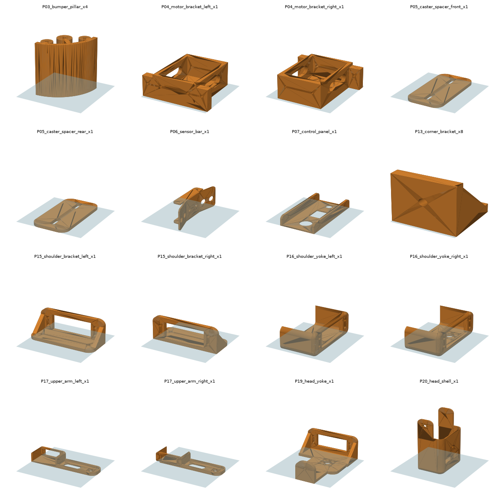

# Fabrication package

Generated by `make_fabrication.py` from `print/` and `laser/`. Part numbers are the item numbers of the parts list in the drawings (`info/wheeled_humanoid_v2_drawings_1.pdf`, sheet 1): **P** = 3D printed, **L** = laser cut, `_x<n>` = quantity to make from that file.

**3D printing:** 16 files, 26 pieces, about 550 g of PLA. Every STL here is already oriented for printing (placed on the bed at z = 0) and fits a 300 x 300 x 300 mm bed; the largest part is the head shell, 197 mm tall. Common settings: PLA, 0.2 mm layers, 0.4 mm nozzle, brim on the tall thin parts (P03, P06, P20).

| No. | File | Qty | Infill | Walls | Orientation on the bed | Supports | Size on bed (mm) | g each | Why these settings |
|---|---|---|---|---|---|---|---|---|---|
| P03 | `P03_bumper_pillar_x4.stl` | 4 | 40 % | 4 | as designed: 6 cm2 flat on the bed | none | 40 x 40 x 65 | 30 | deck spacer, carries the upper deck and torso in compression |
| P04 | `P04_motor_bracket_left_x1.stl` | 1 | 50 % | 4 | as designed: 31 cm2 flat on the bed | none | 72 x 65 x 33 | 38 | holds a gearmotor: robot weight and motor torque |
| P04 | `P04_motor_bracket_right_x1.stl` | 1 | 50 % | 4 | as designed: 31 cm2 flat on the bed | none | 72 x 65 x 33 | 38 | holds a gearmotor: robot weight and motor torque |
| P05 | `P05_caster_spacer_front_x1.stl` | 1 | 100 % | 3 | as designed: 18 cm2 flat on the bed | none | 32 x 60 x 3 | 8 | 3.5 mm shim under a caster: solid |
| P05 | `P05_caster_spacer_rear_x1.stl` | 1 | 100 % | 3 | as designed: 18 cm2 flat on the bed | none | 32 x 60 x 3 | 8 | 3.5 mm shim under a caster: solid |
| P06 | `P06_sensor_bar_x1.stl` | 1 | 25 % | 3 | as designed: 24 cm2 flat on the bed | none (bridges up to 20 mm) | 36 x 160 x 65 | 33 | carries the 2 ToF and 2 ultrasonic sensors: light load |
| P07 | `P07_control_panel_x1.stl` | 1 | 40 % | 4 | as designed: 69 cm2 flat on the bed | none | 65 x 124 x 22 | 35 | holds the E-stop and the switch: must not flex when the button is hit |
| P13 | `P13_corner_bracket_x8.stl` | 8 | 60 % | 4 | as designed: 5 cm2 flat on the bed | none | 24 x 22 x 22 | 5 | joins the torso plates: small and stressed |
| P15 | `P15_shoulder_bracket_left_x1.stl` | 1 | 40 % | 4 | turned: flat contact 11.3 to 17 cm2 | none | 66 x 26 x 31 | 10 | holds a shoulder pitch servo (30 kg.cm) |
| P15 | `P15_shoulder_bracket_right_x1.stl` | 1 | 40 % | 4 | turned: flat contact 11.3 to 17 cm2 | none | 66 x 26 x 31 | 10 | holds a shoulder pitch servo (30 kg.cm) |
| P16 | `P16_shoulder_yoke_left_x1.stl` | 1 | 40 % | 4 | turned: flat contact 0.6 to 17 cm2, bridging 20 to 3 cm2 | none (bridges up to 35 mm) | 36 x 68 x 31 | 17 | pitch horn to roll servo: carries the whole arm |
| P16 | `P16_shoulder_yoke_right_x1.stl` | 1 | 40 % | 4 | turned: flat contact 0.6 to 17 cm2, bridging 20 to 3 cm2 | none (bridges up to 35 mm) | 36 x 68 x 31 | 17 | pitch horn to roll servo: carries the whole arm |
| P17 | `P17_upper_arm_left_x1.stl` | 1 | 30 % | 4 | as designed: 56 cm2 flat on the bed | none | 164 x 40 x 33 | 33 | roll horn to elbow servo, 164 mm lever |
| P17 | `P17_upper_arm_right_x1.stl` | 1 | 30 % | 4 | as designed: 56 cm2 flat on the bed | none | 164 x 40 x 33 | 33 | roll horn to elbow servo, 164 mm lever |
| P19 | `P19_head_yoke_x1.stl` | 1 | 40 % | 4 | as designed: 35 cm2 flat on the bed | none | 66 x 84 x 37 | 22 | pan horn to tilt servo: carries the head |
| P20 | `P20_head_shell_x1.stl` | 1 | 15 % | 3 | as designed: 56 cm2 flat on the bed | build plate only, under the rounded lower edge (first 4 mm) | 74 x 112 x 197 | 90 | cosmetic shell with the camera and the OLED eyes |

How the orientation was chosen: the script tries the six flat orientations and the mesh's stable poses, and keeps the one with the least unsupported overhang (faces steeper than 45 deg), then the largest contact with the bed, then the lowest height; on a tie it keeps the designed orientation. Holes and slots up to 10 mm wide print without support; flat spans up to 45 mm are bridged. Masses: PLA 1.24 g/cm3, walls and top/bottom solid, the rest at the infill ratio.

**Laser cutting:** 11 files, one piece each, 5 mm sheet (acrylic in the digital twin; plywood or MDF works with the same files), about 18.4 m of cut. The machine bed must take a 435 mm part (L08, L09, L11, L12). DXF in mm, 1:1, outline and holes only.

| No. | File | Qty | Size (mm) | Holes | Cut length (m) | Check against the CAD solid |
|---|---|---|---|---|---|---|
| L01 | `L01_lower_deck_x1.dxf` | 1 | 360.0 x 250.0 | 84 | 2.29 | net area +0.01 % |
| L02 | `L02_upper_deck_x1.dxf` | 1 | 360.0 x 250.0 | 121 | 2.89 | net area +0.01 % |
| L08 | `L08_torso_side_left_mega_x1.dxf` | 1 | 110.0 x 435.2 | 20 | 2.19 | net area +0.00 % |
| L09 | `L09_torso_side_right_pi_x1.dxf` | 1 | 110.0 x 435.2 | 18 | 2.16 | net area +0.00 % |
| L10 | `L10_torso_shelf_1_x1.dxf` | 1 | 83.4 x 95.0 | 1 | 0.45 | net area +0.01 % |
| L10 | `L10_torso_shelf_2_x1.dxf` | 1 | 83.4 x 95.0 | 1 | 0.45 | net area +0.01 % |
| L11 | `L11_chest_plate_x1.dxf` | 1 | 435.2 x 216.0 | 15 | 3.0 | net area +0.00 % |
| L12 | `L12_back_plate_x1.dxf` | 1 | 435.2 x 216.0 | 3 | 2.23 | net area +0.00 % |
| L14 | `L14_shoulder_plate_x1.dxf` | 1 | 110.0 x 236.0 | 25 | 1.59 | net area +0.01 % |
| L18 | `L18_forearm_left_x1.dxf` | 1 | 44.0 x 147.0 | 13 | 0.59 | net area +0.02 % |
| L18 | `L18_forearm_right_x1.dxf` | 1 | 44.0 x 147.0 | 13 | 0.59 | net area +0.02 % |

Every DXF is checked against a section of the plate's solid at mid-thickness: net area and number of holes must agree. The forearm files (L18) failed this check (they held an edge view, 38 x 5 mm) and were regenerated from the solid; round holes are written as true circles.

Hardware not in the kit, to request from the organisers: M3 x 10 and M3 x 16 screws, M3 nuts, M3 standoffs, M2.5 standoffs for the Pi.
