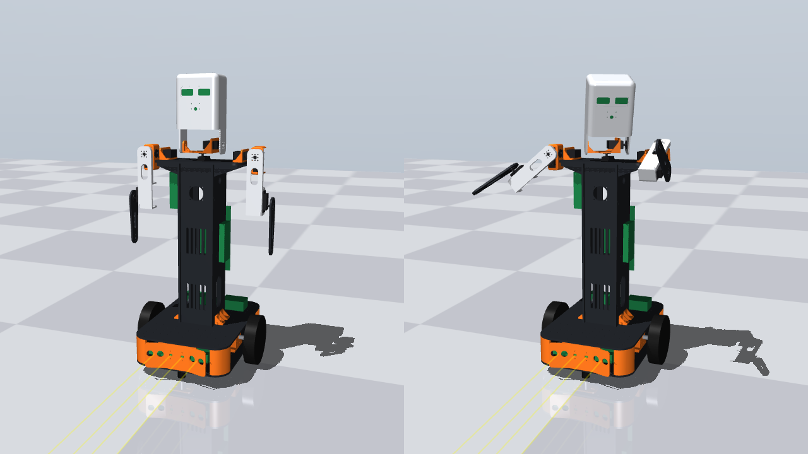

# wheeled_humanoid_v2: digital twin



## What is here

| File | Purpose |
|---|---|
| `generate_twin.py` | **Source of truth.** Reads `../preview/*.stl`, groups the parts into links, places the joints, and writes everything below. Re-run it after any CAD change. |
| `wheeled_humanoid_v2.urdf` | URDF for ROS 2, RViz, Gazebo, PyBullet and Isaac Sim. |
| `wheeled_humanoid_v2.xml` | MuJoCo model with actuators and sensors. |
| `scene.xml` | MuJoCo world: the floor, lights, a test wall 2 m ahead, and the robot. |
| `meshes/` | One STL per part, in metres, already placed in its link's frame. |
| `test_twin.py` | Smoke test: both files load, no self-collision, the robot settles, each joint moves the right way, the robot drives and turns, and the ToF sensor sees the wall. |
| `firmware_sim.py` | **Firmware in the loop.** The Mega controller (`firmware/lib/robot_core`, compiled for this computer) drives the twin through simulated encoders, range sensors, gyro, motors and servos. Runs the `DEMO`, writes `results/`, or serves the serial protocol on TCP. |
| `clearance.py` | Clearance check on the exact CAD solids: each arm and the head swept through the firmware joint ranges, plus the DEMO trajectory. Writes `results/clearance.md`, `.csv` and `clearance_map.png`. |
| `demo_scene.xml` | World for the demonstration: floor and a wall that the robot meets after its 90° turn. |
| `results/` | Output of `firmware_sim.py`: metrics (`demo_metrics.md`, `.json`), signals plot, frames, full log (CSV), events, video. |
| `demo.py` | Scripted motion without the firmware, for a quick look in the viewer. |

## Run it

```bash
pip install mujoco numpy
python3 sim/generate_twin.py      # regenerate (only after CAD changes)
python3 sim/test_twin.py          # 13 checks, should end "ALL CHECKS PASSED"
python3 -m mujoco.viewer --mjcf=sim/scene.xml
python3 sim/firmware_sim.py       # the real firmware runs DEMO on the twin (needs a C++ compiler and make)
```

`firmware_sim.py` overrides a few generic values of the twin with the kit's: servo torque limits from the ratings (TD-8130MG 30, RCXAZ 18, MG996 13 kg·cm), the gearmotors as a DC-motor torque-speed line (10 kg·cm stall, 200 rpm no-load), and wheel damping reduced to bearing friction, because the no-load speed already includes the gearbox losses.

In the viewer, open the **Control** panel on the right and drag the sliders to move each servo or spin each wheel.

## Kinematic tree

```
base_footprint
└── base_link   (decks, torso, battery, motors, electronics, shoulder-pitch and head-pan servos)
    ├── wheel_left_joint   (continuous) → wheel_left_link
    ├── wheel_right_joint  (continuous) → wheel_right_link
    ├── l_sh_pitch_joint → shoulder_yoke_left_link → l_sh_roll_joint → upper_arm_left_link → l_elbow_joint → forearm_left_link
    ├── r_sh_pitch_joint → shoulder_yoke_right_link → r_sh_roll_joint → upper_arm_right_link → r_elbow_joint → forearm_right_link
    ├── head_pan_joint → head_yoke_link → head_tilt_joint → head_link (shell, OLED eyes, camera)
    ├── caster_front_link / caster_rear_link (fixed, frictionless spheres)
    └── imu_link, tof_*_link, sonar_*_link, camera_link (fixed sensor frames)
```

Frames: X forward, Y left, Z up. The origin is on the floor under the robot's centre. Every link frame has the same orientation as the robot, and its origin sits on the shaft of the servo or motor that drives it. The shaft positions were measured from the servo horns in the CAD.

| Joint | Axis | Positive direction | Range |
|---|---|---|---|
| `wheel_left/right_joint` | +Y | rolls the robot forward | continuous |
| `l/r_sh_pitch_joint` | −Y | raises the arm forward | ±90° |
| `l_sh_roll_joint` / `r_sh_roll_joint` | +X / −X | swings the arm outward | ±90° |
| `l/r_elbow_joint` | −Y | bends the forearm forward | ±90° |
| `head_pan_joint` | +Z | turns the head left | ±90° |
| `head_tilt_joint` | +Y | tilts the head to look down | ±45° |

Zero on every joint is the CAD pose: arms hanging down, head facing forward. When you mount the real servo horns, set each servo's 0 to this pose so the twin and the robot share the same zero.

## Values that are estimates (replace them with measurements)

All of these are set at the top of `generate_twin.py`:

- **Joint ranges** in the twin (±90°, head tilt ±45°) are generic. The firmware limits are the ones that matter (`config.h`); `clearance.py` checks them on the CAD solids. Confirm them on the real robot.
- **Servo effort and speed** (0.94 N·m, 6 rad/s) assume an MG996R-class servo. Use the datasheet values for your actual servos.
- **Wheel motor torque and speed** (1 N·m, 30 rad/s) are placeholders. Use your gearmotor's datasheet.
- **Masses.** The laser-cut plates (`laser/`) assume acrylic (1190 kg/m³); if they're plywood or MDF, change `DENSITY_LASER` to about 650–750. The printed parts (`print/`) assume 750 kg/m³ for PLA at 30–40 % infill. Bought parts (servos, motors, battery, boards) use typical datasheet weights. The total comes out at about 4.8 kg. **Weigh the real robot and each subassembly**, then correct the values here.
- **Inertias** come from the mesh volumes, which are all closed solids. The bought parts are treated as uniform solids.
- **Casters** are frictionless spheres, 1.5 mm off the floor in the CAD, so the robot rocks slightly forward or back until one touches. The real robot will do the same.
- **Collisions** use simple boxes and cylinders. The detailed meshes are for display only, which keeps the simulation fast and stable.
- **MuJoCo servo gains** (kp = 8, kv = 0.2) are tuning values. Adjust them until the twin follows a step command the way your real servo does.

## Sensors in the MuJoCo model

- `head_camera`, a 62° FOV camera on the head that looks forward.
- `imu_accel` and `imu_gyro` on the MPU-6050 position. The IMU axes are assumed to match the robot axes; check how the board is actually mounted.
- `tof_left/right` (VL53L0X) and `sonar_left/right` (HC-SR04) rangefinders, which look forward. They read −1 when nothing is in range. MuJoCo has no maximum range, so clip the readings to each sensor's datasheet limit in your code.
- `*_pos` joint encoders for every joint.

## Next steps toward a full twin

1. **Gazebo + ROS 2:** add a `ros2_control` block (position interfaces for the servos, velocity interfaces for the wheels) and a `diff_drive_controller` (wheel separation 0.300 m, radius 0.065 m). Then add Gazebo sensor plugins on the `camera_link`, `imu_link` and range frames.
2. **Close the loop:** run the same control code against the twin and the real robot (through the PCA9685 servo driver and the BTS7960 motor drivers). Log real joint angles and IMU data next to the simulated ones, and tune the masses, gains and friction until the two match.
