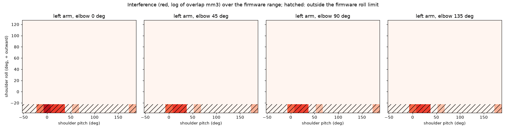

# Clearance check, V2 twin, exact CAD solids

Generated by `sim/clearance.py` in 52 s. A pose interferes when the overlap between two parts grows by more than 5 mm3 over the CAD pose. Ranges are the firmware joint limits (`config.h`), in 15 deg steps (elbow in 45 deg steps, head tilt in 10 deg steps).

## Left arm: 704 poses
- interfering poses in the full range: 21
- interfering poses that the firmware allows (roll >= -15 deg): **0**
- 1 deg sweep: the highest interfering inward roll is **-21 deg** (pitch 15, elbow 0: upper_arm_left / shoulder_plate, 5.7 mm3), so the -15 deg limit leaves 6 deg of margin
- parts that meet (number of poses): upper_arm_left / shoulder_plate (15); upper_arm_left / ref_servo_l_sh_pitch (4); forearm_left / control_11 (2)

## Right arm: 704 poses
- interfering poses in the full range: 32
- interfering poses that the firmware allows (roll >= -15 deg): **0**
- 1 deg sweep: the highest interfering inward roll is **-21 deg** (pitch -30, elbow 0: upper_arm_right / control_12, 5.3 mm3), so the -15 deg limit leaves 6 deg of margin
- parts that meet (number of poses): upper_arm_right / control_12 (16); upper_arm_right / shoulder_plate (12); upper_arm_right / ref_servo_r_sh_pitch (4)

## Head (grid): 91 poses, 0 interfering

## Whole robot (DEMO trajectory): 314 poses, 0 interfering

